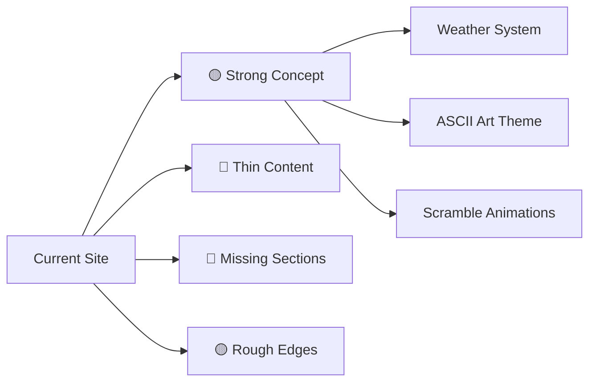
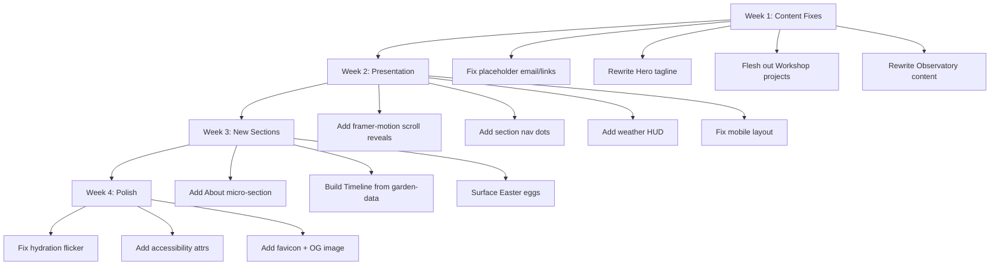

# 🌲 Faeem's ASCII Forest — Content & Presentation Improvement Plan

---

## Current State Assessment

The site has a **strong creative concept** — an ASCII forest world as a portfolio. The weather system, squirrel guide, and scramble-text animations show real craft. But the content is thin in places, and several presentation opportunities are being missed.



---

## 🔴 Priority 1 — Content Gaps (Fix First)

### 1.1 Hero Section — Generic Welcome

**Problem:** The hero says "Welcome to my interactive portfolio" which is generic. No personality, no hook.

**Fix:**
- Replace the subtitle with something that shows who you are in one line
- Add a real tagline that creates curiosity
- The terminal boot sequence is cool but could show *real* info

```
Before: "Welcome to my interactive portfolio. A tiny world built from code, hardware."
After:  "I build TUI apps, wire up ESP32 sensors, and read too much dystopian fiction.
         This forest is what happens when a developer touches grass."
```

**Terminal boot could show:**
```
> python --version... 3.12 [OK]
> soldering_iron.calibrate()... [OK]  
> bookshelf.count()... 47 volumes [OK]
> SYSTEM READY. Explore at your own pace.
```

### 1.2 Workshop Section — Projects Are Too Vague

**Problem:** The 3 project cards have no links, no tech stacks, no outcomes. "Deployed applications and databases" tells a visitor nothing.

**Fix each project card needs:**
- **What it does** (1 sentence)
- **Tech stack** as tags/badges
- **Link** to live demo or GitHub
- **One metric or outcome** ("200+ messages sent", "reads 3 sensor types")

| Project | Current | Should Be |
|---------|---------|-----------|
| Katto | "terminal-based social chat application" | "Real-time TUI chat app — Python, Textual, WebSockets. 4 channels, message history, emoji reactions." |
| IoT | "internet radio and weather station" | "Streams 50+ radio stations on a TFT display. Reads temp/humidity/pressure in real-time. ESP32, MicroPython, DHT11, BMP280." |
| Web Ecosystems | "Deployed applications and databases" | Drop this vague card. Replace with a *specific* project (mediaradar? exist-tv?) with real details. |

### 1.3 Observatory — Empty Promise

**Problem:** The rotating constellation text (`*  T U I S  *`, `.  C L I  .`) is just keywords floating in a box. It doesn't tell the visitor what you're *actually* learning or building next.

**Fix:** Replace with a "Currently exploring" list with real context:
```
🔭 Currently Exploring
├── Advanced Textual widgets (building a file manager TUI)
├── MQTT protocol for IoT device mesh networking  
├── React + Next.js (yes, this site)
└── Contributing to open-source Python tools
```

### 1.4 Campfire — Placeholder Links

**Problem:**
- Email is `your-email@example.com` — placeholder!
- "Freelancer / Upwork" links to `#` — broken!
- No description of what kind of work/collaboration you're looking for

**Fix:**
- Replace email with real email
- Either add real Upwork link or remove it
- Add a one-liner about what you're open to: *"Open to freelance Python/IoT work and open-source collaboration."*

---

## 🟡 Priority 2 — Presentation & Polish

### 2.1 Add Scroll-Triggered Animations (Sections Feel Static)

**Problem:** All sections are visible at once. No sense of *discovery* as you scroll — which undermines the "explore a forest" metaphor.

**Fix:** Use Intersection Observer (you already have `framer-motion` installed but aren't using it!) to:
- Fade+slide each section in when it enters the viewport
- Stagger the list items (skills, project cards)
- The big ASCII art should "grow" in (scale from 0.8 → 1.0)

```tsx
// Example with framer-motion (already in package.json!)
import { motion } from 'framer-motion';

<motion.section
  initial={{ opacity: 0, y: 40 }}
  whileInView={{ opacity: 1, y: 0 }}
  viewport={{ once: true, margin: "-100px" }}
  transition={{ duration: 0.6 }}
>
```

> [!IMPORTANT]
> You're paying for `framer-motion` in bundle size but not using it anywhere. Either use it or remove it.

### 2.2 Section Numbering & Navigation

**Problem:** Sections are numbered [01]–[05] but there's no way to jump between them. On a long scrolling page, visitors get lost.

**Fix:** Add a minimal side navigation — small dots or section numbers fixed to the left edge:

```
  01 ●
  02 ○
  03 ○
  04 ○  
  05 ○
```

Highlights the current section as you scroll. Clicking jumps to that section. Keeps the minimal aesthetic.

### 2.3 The Weather System Needs a HUD

**Problem:** The weather system is your best feature but visitors don't even know it exists. They just see random visual changes with no context.

**Fix:** Add a tiny weather indicator in the corner:

```
┌─────────────┐
│ ☀ SUNNY     │
│ Wind: calm  │
└─────────────┘
```

This turns a confusing background animation into a *feature* people notice and talk about.

### 2.4 Typography Hierarchy Needs Work

**Problem:** Body text and list items all look the same weight/size. Hard to scan.

**Fix:**
- Section subtitles should be dimmer/smaller than section titles
- Skill categories (`Languages:`, `Frameworks:`) should be visually distinct tags, not just bold text in a list
- Add more vertical rhythm — the gap between sections (currently `gap-32 md:gap-64`) is good, but *within* sections everything is cramped

### 2.5 Mobile Experience

**Problem:** 
- The ASCII art tree in Hero is `hidden md:flex` — mobile users miss it entirely
- The squirrel at `position: fixed` may overlap content on small screens
- Section background text ("FOREST", "LIBRARY") at `text-9xl` likely overflows on mobile

**Fix:**
- Show a smaller ASCII art on mobile (scale it down, don't hide it)
- Reduce/hide the squirrel below `640px`, or constrain its movement zone
- Clamp background text: `text-5xl sm:text-7xl md:text-9xl`

---

## 🟢 Priority 3 — Content Additions (New Sections)

### 3.1 Add an "About" Micro-Section After Hero

Right now the site jumps from "Welcome" straight to "Skills." Who is Faeem? Add 2–3 sentences:

```
I'm Faeem — an 18-year-old developer from [location]. I build things
with Python and solder things with ESP32s. When I'm not coding, I'm
reading dystopian fiction or arguing about films on Letterboxd.

This site is a living document. It changes with the weather.
```

### 3.2 Add a "Timeline / Journey" Section

The `garden-data.ts` file has rich concept-node data (curiosity → learning → python → projects) but it's **completely unused**. Turn this into a visual timeline or skill tree:

```
2024 ─── 🌱 First Python script ("Hello World")
     ├── Built Wordle clone
     └── Discovered Textual framework
2025 ─── 🌿 Started IoT with ESP32
     ├── Built internet radio
     ├── Weather station with BMP280
     └── Launched Katto chat app
2026 ─── 🌳 Learning web development
     ├── Built this portfolio (Next.js + React)
     └── Exploring freelance work
```

### 3.3 Add a "Digital Garden" / Blog Section

You have `LIVING_THOUGHTS` and `EASTER_EGG_STORIES` in `garden-data.ts` — great writing hidden in a data file nobody sees. Surface these as:
- A rotating "thought of the day" somewhere visible
- Easter eggs triggered by clicking certain ASCII art elements
- Or a proper `/garden` page with short-form notes

---

## 🔧 Priority 4 — Technical & UX Polish

### 4.1 Hydration Flicker

**Problem:** `LivingBackground` and `Squirrel` use `Math.random()` in render for positions/styles. This causes hydration mismatches (server HTML ≠ client HTML) and layout flicker on load.

**Fix:** Pre-generate random values in state during `useEffect`, not during render. The `LivingBackground` already guards with `if (!mounted) return null` which is correct, but the random values in `style` props still regenerate every render.

### 4.2 Performance — Too Many DOM Nodes

**Problem:** `LivingBackground` creates 100+ absolutely-positioned `<div>` elements with individual animations. On low-end devices this will stutter.

**Fix:**
- Use CSS `will-change: transform` on animated elements
- Consider using a single `<canvas>` for the background instead of DOM nodes
- At minimum, reduce particle counts on mobile via a media query or `navigator.hardwareConcurrency` check

### 4.3 Accessibility

- No `<h1>` landmark in the hero (the h1 exists but as scramble-text, screen readers see empty text during animation)
- ASCII art needs `aria-hidden="true"` or `role="img"` with `aria-label`
- The squirrel is decorative → needs `aria-hidden="true"`
- Color contrast: `--text-dim: #52525b` on `--bg-color: #0d0d0d` = ratio ~3.2:1 (fails WCAG AA for body text)

### 4.4 SEO & Social Sharing

- No `favicon.ico` in `/public`
- No OG image for social sharing previews
- No `robots.txt` or `sitemap.xml`

---

## Implementation Priority



> [!TIP]
> Start with **Priority 1** — it's all content changes, no code. You can ship improved text in 30 minutes and the site immediately feels more real and personal.
