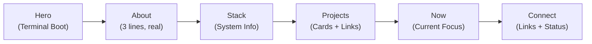
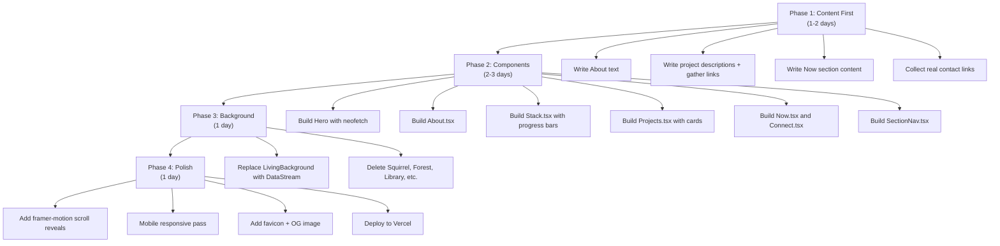

# ⌨️ Portfolio Redesign — Tech + Personal, ASCII Style

> Drop the forest. Keep the aesthetic. Build a real portfolio.

---

## The Pivot

| **Kill** | **Keep** | **Add** |
|----------|----------|---------|
| Forest/garden/nature metaphors | ASCII art style | Real project cards with links |
| Squirrel mascot | Monospace typography (JetBrains Mono) | About section with personality |
| Tree/campfire/observatory naming | Scramble-text reveal animation | Tech stack as system readout |
| `garden-data.ts` concept nodes | Dark terminal aesthetic | Timeline / journey |
| "Biomes" and "seeds" language | Weather system → reimagined as **System Status** | Proper contact with real links |
| "Explore the forest" framing | Color palette (green accent on dark) | Section navigation |

---

## New Site Structure

```
┌──────────────────────────────────────────┐
│  [01] HERO — Terminal boot + intro       │
│  [02] ABOUT — Who I am, 3 sentences     │
│  [03] STACK — Tech as system readout     │
│  [04] PROJECTS — Real cards, real links  │
│  [05] NOW — What I'm building today     │
│  [06] CONNECT — Links + availability    │
└──────────────────────────────────────────┘
```



---

## Section-by-Section Plan

### [01] Hero — Terminal Boot

**Vibe:** You just SSH'd into faeem's machine. The screen boots up.

**Remove:**
- The tree ASCII art on the right side
- "Digital Forest" title
- "Also known in the wild as mando"
- "Scroll to explore" bouncing arrow

**Replace with:**

```
┌─────────────────────────────────────────────────┐
│                                                 │
│   faeem@portfolio:~$                            │
│                                                 │
│   > Faeem Ahmed                                 │
│   > Developer. Hardware Hacker. Builder.        │
│                                                 │
│   I write Python, solder ESP32s, and ship       │
│   things that work. Currently 18, building      │
│   full-time.                                    │
│                                                 │
│   ┌─ terminal ──────────────────────────────┐   │
│   │ $ neofetch                              │   │
│   │ OS:     Web + Hardware                  │   │
│   │ Shell:  Python 3.12                     │   │
│   │ IDE:    VS Code + Soldering Iron        │   │
│   │ Uptime: 18 years                        │   │
│   │ Status: Building...                     │   │
│   └─────────────────────────────────────────┘   │
│                                                 │
│   ↓ scroll                                      │
│                                                 │
└─────────────────────────────────────────────────┘
```

**ASCII art:** Replace the tree with a `neofetch`-style system info block. Still ASCII, but *developer-native*.

---

### [02] About — Who I Am

**This section doesn't exist yet.** Add it.

**Vibe:** Honest, short, no buzzwords. Let the reader know who they're looking at.

```
┌─────────────────────────────────────────────────┐
│                                                 │
│  [02] about.txt                                 │
│                                                 │
│  I'm Faeem — an 18-year-old developer who       │
│  builds terminal apps, wires up IoT sensors,    │
│  and deploys things to the internet.            │
│                                                 │
│  I taught myself Python by building a Wordle    │
│  clone, then got into hardware because I        │
│  wanted my code to affect the physical world.   │
│                                                 │
│  When I'm not coding, I'm reading 1984 for      │
│  the third time or arguing about films on       │
│  Letterboxd.                                    │
│                                                 │
│  I don't have a CS degree. I have shipped       │
│  projects.                                      │
│                                                 │
└─────────────────────────────────────────────────┘
```

> [!IMPORTANT]  
> This is the most important section on the site. 3–5 sentences that make someone want to keep scrolling. Rewrite this in your voice — the above is a starting draft.

---

### [03] Stack — System Readout

**Replaces:** Forest section (skills list)

**Vibe:** `htop` / `neofetch` / system diagnostics — not a boring skills grid.

```
┌─────────────────────────────────────────────────┐
│  [03] cat stack.yml                             │
│                                                 │
│  languages:                                     │
│    - Python        ████████████████░░  90%      │
│    - JavaScript    ██████████░░░░░░░░  55%      │
│    - HTML/CSS      ████████████████░░  85%      │
│    - MicroPython   ██████████████░░░░  70%      │
│                                                 │
│  frameworks:                                    │
│    [Textual] [FastAPI] [Flask] [Scrapy]         │
│    [Next.js] [React] [Tailwind CSS]             │
│                                                 │
│  hardware:                                      │
│    [ESP32] [DHT11] [BMP280] [TFT Displays]     │
│    [I2C] [SPI] [UART]                           │
│                                                 │
│  infrastructure:                                │
│    [Supabase] [Firebase] [MongoDB]              │
│    [Vercel] [Render] [Railway]                  │
│                                                 │
│  tools:                                         │
│    [Git] [VS Code] [Linux] [Docker]             │
│                                                 │
└─────────────────────────────────────────────────┘
```

**ASCII art:** Replace the tree with a small terminal/computer:
```
    .───────────.
    |  >_       |
    |  ████░░   |
    |  ██████░  |
    '───────────'
       /____\
```

**Interactive idea:** Progress bars animate in when section scrolls into view.

---

### [04] Projects — Real Cards

**Replaces:** Workshop section

**Vibe:** Each project is a file you can `cat`. Real descriptions, real links, real tech.

```
┌─────────────────────────────────────────────────┐
│  [04] ls ~/projects                             │
│                                                 │
│  ┌─ katto.md ──────────────────────────────┐    │
│  │                                         │    │
│  │  .=========.                            │    │
│  │  | [=====] |    💬 Katto                │    │
│  │  |         |    Real-time terminal chat │    │
│  │  |_________|    ───────────────────     │    │
│  │                                         │    │
│  │  Python · Textual · WebSockets          │    │
│  │                                         │    │
│  │  A TUI-based social chat app.           │    │
│  │  Multiple channels, message history,    │    │
│  │  live presence indicators.              │    │
│  │                                         │    │
│  │  [GitHub ↗]  [Demo ↗]                   │    │
│  └─────────────────────────────────────────┘    │
│                                                 │
│  ┌─ iot-radio.md ──────────────────────────┐    │
│  │                                         │    │
│  │   .───.                                 │    │
│  │  | ))) |    📻 Internet Radio           │    │
│  │   '───'     ESP32 streaming device      │    │
│  │             ──────────────────────      │    │
│  │                                         │    │
│  │  ESP32 · MicroPython · TFT · I2C       │    │
│  │                                         │    │
│  │  Streams 50+ radio stations on a        │    │
│  │  1.8" TFT display. Rotary encoder       │    │
│  │  for station switching. Runs 24/7.      │    │
│  │                                         │    │
│  │  [GitHub ↗]  [Photos ↗]                 │    │
│  └─────────────────────────────────────────┘    │
│                                                 │
│  ┌─ weather-station.md ────────────────────┐    │
│  │                                         │    │
│  │     ╭──╮                                │    │
│  │     │°C│    🌡️ Weather Station          │    │
│  │     ╰──╯    Environmental monitor       │    │
│  │             ──────────────────────      │    │
│  │                                         │    │
│  │  ESP32 · DHT11 · BMP280 · Supabase     │    │
│  │                                         │    │
│  │  Reads temperature, humidity, and       │    │
│  │  barometric pressure. Logs to           │    │
│  │  Supabase. Web dashboard for history.   │    │
│  │                                         │    │
│  │  [GitHub ↗]  [Dashboard ↗]              │    │
│  └─────────────────────────────────────────┘    │
│                                                 │
└─────────────────────────────────────────────────┘
```

> [!TIP]
> Split the old "IoT Creations" into two separate project cards (radio + weather station). Each project deserves its own space with specific details.

---

### [05] Now — Current Focus

**Replaces:** Observatory section

**Vibe:** A `/now` page — what you're working on *right now*. Updated periodically.

```
┌─────────────────────────────────────────────────┐
│  [05] cat ~/.now                                │
│                                                 │
│  Last updated: Nov 2026                         │
│                                                 │
│  > Building a TUI file manager in Python        │
│  > Learning React + Next.js (built this site)   │
│  > Experimenting with MQTT for IoT mesh         │
│  > Reading: "Brave New World" by Huxley         │
│  > Watching: films rated on Letterboxd          │
│                                                 │
│  Status: open to freelance Python/IoT work      │
│                                                 │
└─────────────────────────────────────────────────┘
```

Short. Honest. Updated when things change. Shows you're active.

---

### [06] Connect — Links + Availability

**Replaces:** Campfire section

**Vibe:** Clean, functional. No animated fire — just a clear way to reach you.

```
┌─────────────────────────────────────────────────┐
│  [06] cat contacts.json                         │
│                                                 │
│  {                                              │
│    "github":      "github.com/faeemaxp",        │
│    "email":       "faeem@actual-email.com",      │
│    "letterboxd":  "letterboxd.com/faeem",        │
│    "discord":     "faeem#1234",                  │
│    "status":      "open to work"                 │
│  }                                              │
│                                                 │
│  // EOF                                         │
│                                                 │
└─────────────────────────────────────────────────┘
```

---

## Background System — Reimagined

### Weather → System Status Monitor

**Remove:** Trees, grass, mountains, hills, leaves, clouds shaped like `~~~`

**Keep/Transform:** The idea of a living, changing background — but make it tech-themed.

| Old (Nature) | New (Tech) |
|---|---|
| Stars twinkling | Matrix-style falling characters |
| Rain / snow | Data packets streaming down |
| Clouds moving | Floating code snippets / comments |
| Trees swaying | None — clean it up |
| Grass | Scanlines or grid |
| Weather HUD | System status: `CPU: 42% · MEM: 2.1GB · UPTIME: 18y` |

The background becomes a subtle **matrix rain / data stream** that changes intensity based on a "system load" state instead of weather.

### Squirrel → Remove

The squirrel doesn't fit a tech portfolio. Remove it entirely. If you want a cursor-follower, make it a blinking terminal cursor `▊` that subtly tracks scroll position — but honestly, removing it is cleaner.

---

## Component Mapping

| Old Component | Action | New Component |
|---|---|---|
| `Hero.tsx` | **Rewrite** | Terminal boot + neofetch |
| `Forest.tsx` | **Rewrite** → `Stack.tsx` | System readout with progress bars |
| `Library.tsx` | **Delete** | Merge interests into About |
| `Workshop.tsx` | **Rewrite** → `Projects.tsx` | Real project cards with links |
| `Observatory.tsx` | **Rewrite** → `Now.tsx` | Current focus / status |
| `Campfire.tsx` | **Rewrite** → `Connect.tsx` | JSON-style contact block |
| `Squirrel.tsx` | **Delete** | — |
| `LivingBackground.tsx` | **Rewrite** | Matrix/data stream background |
| `AsciiText.tsx` | **Keep** | Still great |
| `garden-data.ts` | **Delete** | No longer needed |
| `pretext.ts` | **Keep** | Scramble util still used |
| — | **New** → `About.tsx` | Personal intro section |
| — | **New** → `SectionNav.tsx` | Side dot navigation |

---

## New Page Structure

```tsx
// src/app/page.tsx
export default function Home() {
  return (
    <main>
      <DataStream />       {/* Background: matrix rain */}
      <SectionNav />       {/* Fixed side dots: 01–06 */}
      
      <div className="content">
        <Hero />           {/* [01] Terminal boot */}
        <About />          {/* [02] about.txt */}
        <Stack />          {/* [03] cat stack.yml */}
        <Projects />       {/* [04] ls ~/projects */}
        <Now />            {/* [05] cat ~/.now */}
        <Connect />        {/* [06] contacts.json */}
      </div>
    </main>
  );
}
```

---

## Implementation Order



> [!NOTE]
> **Phase 1 is writing, not coding.** Get the words right first. The best portfolio is one where the content is strong enough to work in plain HTML.

---

## What Stays the Same

These are the things that make the site *yours* — don't touch them:

- ✅ **JetBrains Mono** everywhere
- ✅ **Dark background** (`#0d0d0d`)
- ✅ **Green accent** (`#22c55e`) as primary
- ✅ **Color palette** (purple, cyan, lime, orange, pink, indigo)
- ✅ **Scramble-text reveal** animation
- ✅ **Monospace terminal feel** — everything looks like a file or command
- ✅ **Section numbering** `[01]` through `[06]`
- ✅ **ASCII art** per section (but developer-themed, not nature-themed)
