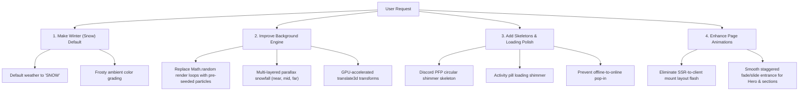

# ❄️ Plan: Default Winter Atmosphere, Background Engine & Loading Polish

> Set the winter/snow environment as the permanent default, optimize background particle performance, and add slick loading skeletons and entrance animations.

---

## 1. Objectives & Overview

---

## 2. Detailed Technical Plan

### Part 1: Winter Theme as Default
* **Initial Weather State:** Change default in `LivingBackground.tsx` from `'CLEAR'` to `'SNOW'`.
* **Atmospheric Palette:**
  * Snow particle colors: `#f8fafc`, `#e2e8f0`, `#cbd5e1`, and frosty cyan accent `#a5f3fc`.
  * Ambient overlay: A soft winter dusk gradient (`#060c18/40` via transparent to `#0a1120/50`) that evokes a cold night while preserving dark terminal contrast.
  * Tree and ground frost: Gentle cool tones on the ASCII horizon line (`#94a3b8` / `#64748b`) instead of harsh desert colors.
* **Weather Rotation:** Winter remains the active baseline experience; weather transitions can be made optional or keep snow as the anchor theme.

---

### Part 2: Background Engine Optimization & Depth
* **The Problem:** The current background generates particles on the fly with `Math.random()` inside JSX styles during render. This triggers React 19 purity warnings, causes recalculation on re-renders, and drops frames on lower-powered devices.
* **The Solution:**
  1. **Pre-computed Seed Array:** Generate 40–50 snowflakes once with pre-calculated speeds, horizontal drift offsets, sizes, and opacities.
  2. **Three-Layer Depth (Parallax Snowfall):**
     * **Background layer:** Small dots (`.`), slow falling, dim opacity (`20%`).
     * **Midground layer:** Asterisks (`*`, `o`), medium speed, normal opacity (`45%`).
     * **Foreground layer:** Crisp snowflakes (`❄`, `*`), gentle horizontal drift, full opacity (`75%`).
  3. **Performance Polish:**
     * Use CSS `transform: translate3d(...)` instead of raw top/left offsets for GPU compositor acceleration.
     * Add `will-change: transform` and `contain: strict` to the background canvas container to eliminate reflows.

---

### Part 3: Skeletons & Initial Loading Experience
* **Discord Widget Skeleton ([`DiscordHeroCard.tsx`](file:///D:/r%20poject/src/components/DiscordHeroCard.tsx)):**
  * **Current behavior:** While waiting for Lanyard WebSocket / REST data, it defaults to a generic gray icon and "Offline", then abruptly pops to the user's avatar and "Online".
  * **Improvement:**
    * Circular avatar shimmer skeleton: `w-28 h-28 sm:w-36 sm:h-36 rounded-full bg-white/5 animate-pulse border border-white/10`.
    * Activity pill skeleton: `w-32 h-6 rounded-full bg-white/5 animate-pulse mt-3`.
    * Smooth crossfade once Lanyard delivers real presence data.
* **Eliminate Mount Flash:**
  * Replace `if (!mounted) return null` in `LivingBackground.tsx` with a lightweight, SSR-safe static backdrop so the browser doesn't flash black before hydrating.
* **Scramble Text Smoothing ([`AsciiText.tsx`](file:///D:/r%20poject/src/components/AsciiText.tsx)):**
  * Prevent blank gaps before scramble triggers by showing a subtle, dim placeholder with exact character length to avoid Cumulative Layout Shift (CLS).

---

### Part 4: Smooth Section & Page Animations
* **Hero Entrance:**
  * Hero elements fade and glide in gently (`opacity: 0, translateY: 12px` → `opacity: 1, translateY: 0`) using pure CSS keyframes with zero bundle overhead.
* **Interactive Polish:**
  * Snowflake hover reaction or gentle mouse drift reactivity for subtle organic depth.

---

## 3. Files to Modify

| File | Proposed Changes |
| :--- | :--- |
| [`src/components/LivingBackground.tsx`](file:///D:/r%20poject/src/components/LivingBackground.tsx) | Set default to `SNOW`, replace random renders with pre-seeded 3-layer parallax particle system, add winter ambient glow. |
| [`src/components/DiscordHeroCard.tsx`](file:///D:/r%20poject/src/components/DiscordHeroCard.tsx) | Add clean pulsing skeleton state while Lanyard data is loading, smooth presence transition. |
| [`src/components/AsciiText.tsx`](file:///D:/r%20poject/src/components/AsciiText.tsx) | Prevent layout shift before start delay; optimize text reveal transitions. |
| [`src/app/globals.css`](file:///D:/r%20poject/src/app/globals.css) | Add optimized GPU keyframes for drifting snowflakes (`snowFallDrift`, `shimmerSkeleton`). |

---

## 4. Verification & Testing Steps
1. Verify `SNOW` is active immediately on cold page load with zero flash.
2. Confirm Discord avatar and activity pill display smooth pulsing skeletons during initial data fetch.
3. Test CPU usage in Chrome DevTools to ensure 60fps rendering without frame drops.
4. Run `npm run lint` and `npx next build` to guarantee zero errors and clean static page generation.
